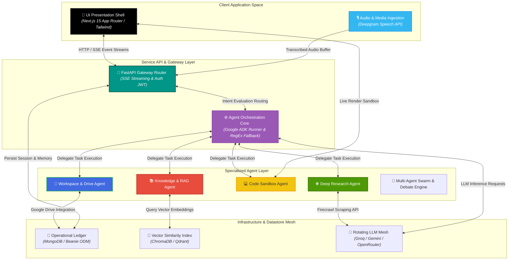

<div align="center">

# 🤖 Agentic — Multi-Agent AI Platform

### Enterprise-Grade Agent Orchestration Infrastructure, Retrieval-Augmented Generation & Multi-LLM Execution Mesh

**Agentic** is a high-performance, full-stack multi-agent workspace engineered to route user intents across specialized AI agents, vector datastores, and external execution sandboxes. By combining Google Agent Development Kit (ADK) orchestration, an auto-rotating LLM fallback chain, and isolated service workers, the platform handles complex RAG pipelines, real-time code execution, and web research loops without thread blocks or interface latency.

<p align="center">
  
  
  
  
  
  
</p>

<p align="center">
  <a href="https://github.com/shreeharsh-patil/multi-agent-platform/stargazers"></a>
  <a href="https://github.com/shreeharsh-patil/multi-agent-platform/issues"></a>
  <a href="LICENSE"></a>
</p>

</div>

---

## 🏛️ System Architecture & Agent Orchestration Topology

Standard single-prompt LLM wrappers degrade under complex multi-step user tasks, hitting context limits or generating hallucinations. **Agentic** resolves this using an **Asynchronous ADK Orchestration Pattern**. 

A root orchestrator evaluates incoming intents, routes tasks to domain-specialized agents (e.g., Knowledge, Coding, Research), and delegates execution to isolated tools. Streaming events use Server-Sent Events (SSE) to push token-by-token updates directly to the client state manager.



> [!NOTE]
> Resilient LLM Design: To prevent service interruptions from rate limits, the RotatingProvider service manages failovers across Groq, Gemini, OpenRouter, Mistral, and NaraRouter transparently during stream execution.

### 🔄 End-to-End Orchestration & Retrieval Lifecycle

The sequence blueprint below illustrates how user prompts route through intent parsing, retrieval pipelines, tool execution, and stream synthesis:

```mermaid
sequenceDiagram
    autonumber
    actor User as Workspace User
    participant UI as Next.js App Shell
    participant API as FastAPI Event Server
    participant OR as ADK Orchestrator
    participant VS as Vector Database
    participant LLM as Provider Execution Mesh

    User->>UI: Submit Multi-Modal Query or Document Context
    UI->>API: Initiate SSE Stream Transport Payload
    API->>OR: Parse Query & Evaluate Active Intents
    
    rect rgb(20, 30, 20)
        note over OR,VS: Semantic Retrieval Window (If Document QA)
        OR->>VS: Query Embeddings (Google text-embedding-004)
        VS-->>OR: Return Ranked Relevant Document Chunks
    end

    rect rgb(30, 20, 40)
        note over OR,LLM: Agent Delegation & Tool Invocation
        OR->>LLM: Dispatch Prompt + Context to Specialized Agent
        LLM-->>OR: Yield Token Stream + Functional Tool Calls
    end

    OR->>API: Stream SSE Token Chunks & Visual Components
    API-->>UI: Dynamic Render (Markdown / Code Sandbox / Quiz)
    API->>API: Persist Conversation Context to MongoDB
    UI-->>User: Complete Interactive Stream Output
```



### 🛠️ Production Pipeline Implementation

| Pipeline Component | Technical Infrastructure Challenge | Enterprise Engineering Solution |
|---|---|---|
| 🔄 Provider Failover | API rate limits and provider outages interrupt chat generation. | Uses an auto-rotating LLM pool (RotatingProvider) that shifts requests across Groq, Gemini, and OpenRouter without dropping sessions. |
| ⚡ High-Density RAG | Ingestion of large PDFs and images causes high query latency and memory usage. | Implements asynchronous chunking and vector storage (ChromaDB/Qdrant) with Gemini text-embedding-004 vectors. |
| 💻 Code Execution | Displaying static code blocks limits interactive verification and developer productivity. | Uses an inline code sandbox client that detects, compiles, and renders live HTML/CSS/JS output directly within chat threads. |
| 🧠 Memory Persistence | Context loss across sessions harms personalized agent workflows. | Extracts user facts and operational parameters automatically, storing them in a persistent MongoDB memory ledger. |

---

### 🎨 Interface Showcase

---

## 🚀 Deployment & Local Initialization

### Prerequisites

- **Runtime Environments:** Python >= 3.11, Node.js >= 18.x
- **Database Cluster:** MongoDB (Local or Docker container)
- **API Access:** Google Gemini API Key (Required for embeddings & ADK baseline)

### Environment Setup Sequences

**1. Repository Instantiation**

```bash
git clone https://github.com/shreeharsh-patil/multi-agent-platform.git
cd multi-agent-platform
```

**2. Backend Initialization**

```bash
cd backend
python -m venv .venv

# Activate virtual environment
# Windows: .venv\Scripts\activate | Linux/macOS: source .venv/bin/activate
source .venv/bin/activate

pip install -r requirements.txt
```

**3. Frontend Initialization**

```bash
cd ../frontend
npm install
```

**4. Environment Variables Configuration**

Copy `.env.example` to the project root `.env`:

```ini
# Core AI Services
GEMINI_API_KEY="your_google_gemini_api_key"
LLM_PROVIDER="groq" # Options: groq, gemini, openrouter, mistral

# Database & Vector Stores
MONGODB_URI="mongodb://localhost:27017/agentic_db"
VECTOR_DB_PROVIDER="chroma" # Options: chroma, qdrant

# Authentication & Tokens
SECRET_KEY="your_secure_jwt_secret_key"
NEXTAUTH_SECRET="your_nextauth_secret_key"

# Optional Extensions
DEEPGRAM_API_KEY="your_deepgram_speech_token"
FIRECRAWL_API_KEY="your_firecrawl_search_token"
```

### Running the Application

**Option A: Native Development Servers**

Start Backend Gateway (FastAPI):

```bash
cd backend
uvicorn src.main:app --reload --port 8000
```

Start Frontend Application (Next.js 15):

```bash
cd frontend
npm run dev
```

Access UI at: **http://localhost:3000** | Interactive API Docs: **http://localhost:8000/docs**

**Option B: Containerized Infrastructure (Docker Compose)**

```bash
docker compose up --build -d
```

### 🧪 Automated Testing & Continuous Integration

Run backend unit and integration test suite:

```bash
cd backend
pytest -v
```

The project includes an automated **GitHub Actions CI Pipeline** (`.github/workflows/ci.yml`) that validates every commit against:
- Backend FastAPI route health check and auth envelope responses
- `AgentRegistry` and custom `BaseAgent` manifest registrations
- `AgentRouter` natural language intent evaluation engine
- Next.js 15 frontend type checking and production build bundle compilation

---

## 📁 Repository Directory Architecture

```
multi-agent-platform/
├─ backend/                         (FastAPI High-Performance Engine)
│  ├─ src/
│  │  ├─ agents/                    (ADK Runner, AgentRouter, and specialized LlmAgents)
│  │  ├─ services/                  (LLM Rotator, RAG Pipeline, Vector Store, Memory Engine)
│  │  ├─ models/                    (Beanie MongoDB ODM Collections & Schemas)
│  │  ├─ api/                       (REST Routes, SSE Streaming controllers, Auth paths)
│  │  └─ main.py                    (FastAPI Application Entry Point)
│  └─ requirements.txt              (Python runtime package manifests)
├─ frontend/                        (Next.js 15 App Router Workspace)
│  ├─ src/
│  │  ├─ app/                       (App Router layouts, pages, and API handlers)
│  │  ├─ components/                (Modular UI Cards, Code Sandbox, Chat Streams)
│  │  ├─ hooks/                     (SSE state consumers, voice recorders, workspace hooks)
│  │  └─ lib/                       (API clients, utils, state management stores)
│  └─ package.json                  (Frontend package declarations)
├─ docker-compose.yml               (Container orchestration for MongoDB, Qdrant, & Backend)
└─ README.md                        (Unified platform documentation)
```

---

## ⚖️ Legal Guidelines & License

> [!WARNING]
> This software is distributed under the MIT License. It is built for multi-agent system research, document RAG experiments, and software engineering portfolio evaluations. Production environments should implement proper token usage monitoring, sandbox access limits, and enterprise security policies.

---

### 👤 Project Author

Developed and Maintained by **Shreeharsh Patil**.

Feel free to contact me or submit issues via:

- **Email:** shreeharsh.dev@gmail.com
- **GitHub Profile:** [github.com/shreeharsh-patil](https://github.com/shreeharsh-patil)
